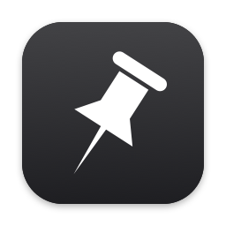
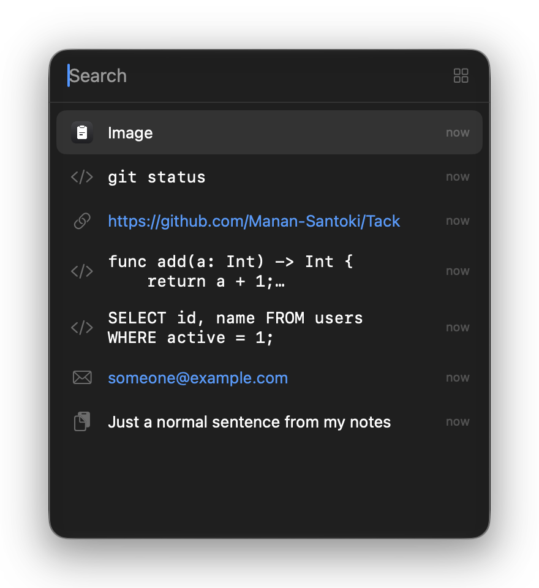
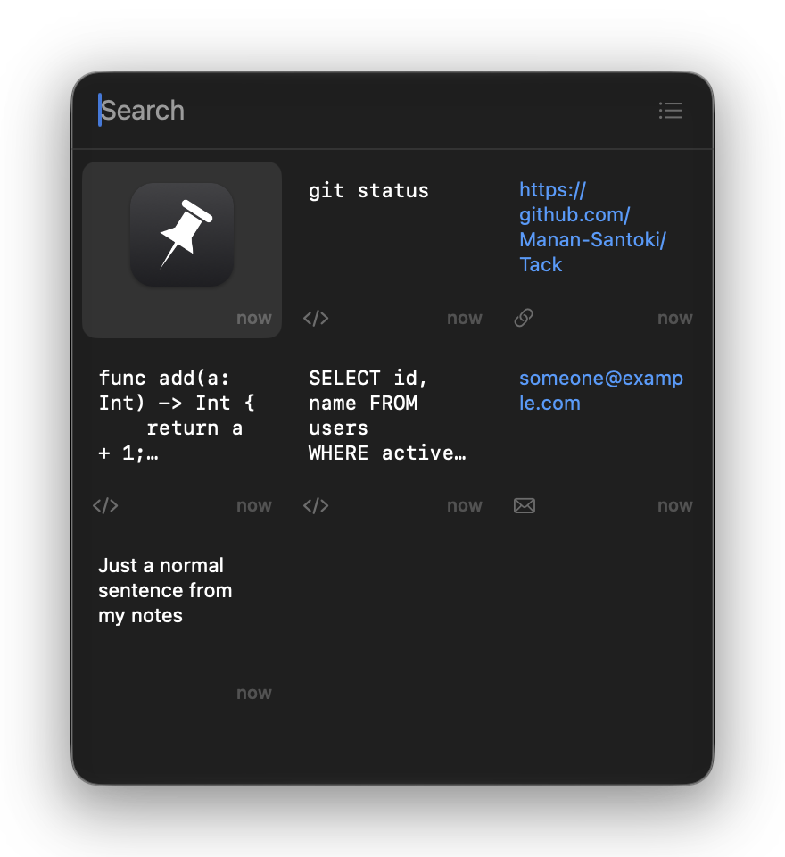

<div align="center">



# Tack

**A minimal, native clipboard manager for Mac.**

Press a shortcut, and your history opens right where you're typing. Pick a clip, and it pastes exactly as you copied it.

[](https://github.com/Manan-Santoki/Tack/actions/workflows/ci.yml)
[](https://github.com/Manan-Santoki/Tack/releases/latest)
[](#install)
[](LICENSE)

[**Download for Mac**](https://github.com/Manan-Santoki/Tack/releases/latest/download/Tack.dmg)




</div>

## Features

- **Opens where you're typing:** at the text cursor, or the focused field or mouse pointer in apps that don't report their cursor.
- **Keeps the original:** images stay full resolution, and rich text and multiple files stay intact. Every format is saved byte for byte.
- **Knows what you copied:** links, email addresses and code are detected, and searching "link" or "code" finds them.
- **Search that forgives:** finds letters in order and typos, searches the whole clip, and reads the text in images, all on your Mac.
- **List or grid:** list favours text, grid favours image previews.
- **Pins:** pinned clips stay at the top and are never removed by the history limit.
- **Private:** history is encrypted and stays on your Mac. Passwords are skipped by default.
- **Your choice on other devices:** record or ignore clips arriving from your iPhone through Universal Clipboard.
- **Automatic updates:** new versions install themselves, and only if they're signed with Tack's own certificate.
- **Native:** Swift and SwiftUI with no dependencies.

## Install

1. [Download Tack.dmg](https://github.com/Manan-Santoki/Tack/releases/latest/download/Tack.dmg), open it, and drag Tack to Applications.
2. Tack isn't notarized by Apple, so macOS blocks a first install until you clear the quarantine flag:
   ```bash
   xattr -d com.apple.quarantine /Applications/Tack.app
   ```
3. Open Tack and allow it under System Settings → Privacy & Security → Accessibility. It needs this to paste for you and to find the text cursor.
4. If a Keychain prompt appears, click **Always Allow**. Tack keeps its encryption key there.

You only do this once. Tack updates itself, and keeps its permissions when it does. You can turn that off in Settings.

Tack needs macOS 26 or later. To build it yourself, see [CONTRIBUTING.md](CONTRIBUTING.md).

## Usage

| Action | Shortcut |
|---|---|
| Open or close | `⌘⇧V` (change it in Settings) |
| Search | Just type |
| Move | `↑` `↓` (and `←` `→` in grid) |
| Switch list and grid | `⌘L` |
| Paste | `↵` |
| Paste as plain text | `⇧↵` |
| Paste by position | `⌘1` to `⌘9` |
| Pin or unpin | `⌘P` |
| Delete | `⌘⌫` |
| Close | `Esc` or click away |

Right-click a clip for more actions, like opening a link. Settings is in the menu bar icon's menu.

## Limits

- Copied files are stored as references, so a file clip stops working if the original is moved or deleted.
- A single clip is limited to 200 MB. Above that, its largest formats aren't kept.
- Some apps don't report their text cursor. Tack falls back to the focused field or the mouse pointer there.

## Project

- [Changelog](CHANGELOG.md)
- [Contributing and releasing](CONTRIBUTING.md)
- [Security](SECURITY.md)

Tack started as a fork of [ClipHistory](https://github.com/weiykong/ClipHistory) by weiykong. [MIT licensed](LICENSE).
